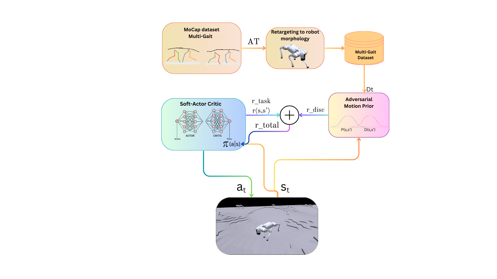

# Unlocking the Potential of Soft Actor-Critic for Imitation Learning

ICRA 2026 · [Paper](https://arxiv.org/abs/2509.24539)

Most imitation learning frameworks for legged robots rely on on-policy PPO. This paper combines **Adversarial Motion Priors (AMP)** with off-policy **Soft Actor-Critic (SAC)**. On a simulated Unitree Go2 learning walk and trot from dog motion capture, AMP+SAC keeps task execution stable and achieves higher imitation rewards than AMP+PPO, on both flat and wave terrain, at the cost of longer training.

<p align="center">
  
</p>

## Code

| Repository | Role |
|---|---|
| [xRL-IL](https://github.com/nayariml/xRL-IL) | AMP+SAC implementation. Start here for setup. |
| [AMP_for_hardware](https://github.com/nayariml/AMP_for_hardware) | Fork of the [AMP+PPO baseline](https://github.com/escontra/AMP_for_hardware) (Escontrela et al., IROS 2022), extended with the Go2. Provides the Isaac Gym simulation and the motion loader. |

This repository holds the paper's figures and additional plots. 


## Citation

```bibtex
@inproceedings{lessa2026unlocking,
  title={Unlocking the Potential of Soft Actor--Critic for Imitation Learning},
  author={Lessa, Nayari Marie and Boukheddimi, Melya and Kirchner, Frank},
  booktitle={2026 IEEE International Conference on Robotics and Automation (ICRA)},
  pages={6105--6112},
  year={2026},
  organization={IEEE}
}
```
